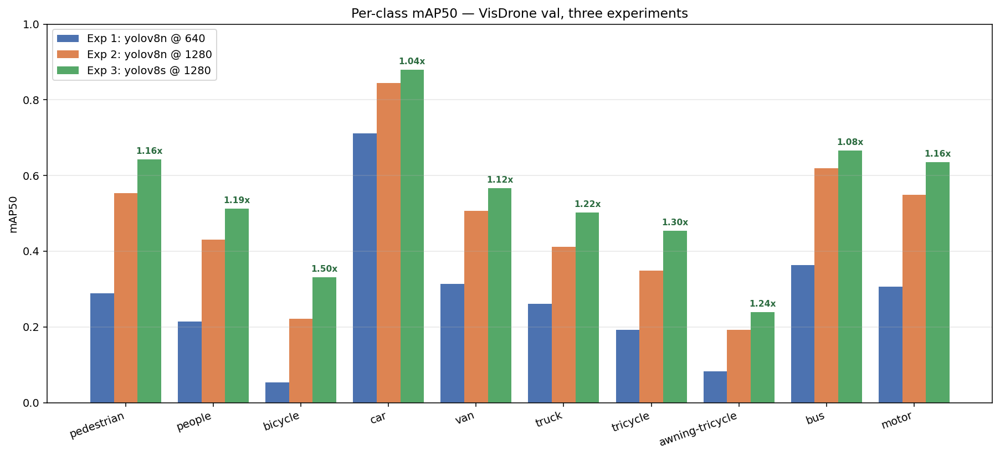
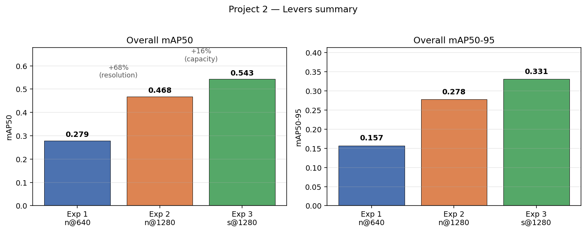
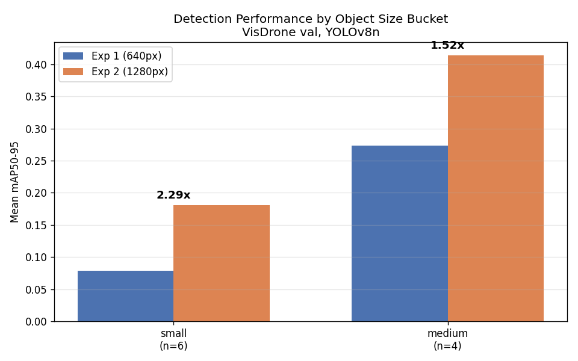

# Project 2: Object Detection on VisDrone

**Course:** AI-driven Perception, Learning and Mapping for Drones — Modules 2, 5, 33–34
**Status:** Complete
**Date:** November 2026

## Summary

A YOLOv8 object detector trained on VisDrone2019-DET — a benchmark for aerial drone imagery with tiny, densely-packed objects. This project investigates which factor drives detection performance more: **input resolution** or **model capacity**.

## Results

| Exp | Model | imgsz | mAP50 | mAP50-95 | Training time |
|---|---|---|---|---|---|
| 1 | yolov8n (3.0M params) | 640 | 0.279 | 0.157 | 67 min |
| 2 | yolov8n (3.0M params) | 1280 | 0.468 | 0.278 | 2.95 hr |
| 3 | yolov8s (11.1M params) | 1280 | **0.543** | **0.331** | 3.26 hr |

**Key finding:** Input resolution is the dominant lever (+68% mAP50 from 640→1280), and capacity is secondary (+16% from nano→small at 1280). Both compound. A size-stratified analysis proves the resolution gain is concentrated in small objects.

## Dataset

[VisDrone2019-DET](https://github.com/VisDrone/VisDrone-Dataset):

- **6,471 training images**, 548 validation images
- **10 classes**: pedestrian, people, bicycle, car, van, truck, tricycle, awning-tricycle, bus, motor
- **Up to 902 objects per image** (auto-raised `max_det=902`)
- Bounding boxes are **tiny**: median side length for pedestrian = 17.2 px

## Experiments

### Experiment 1 — Baseline (yolov8n @ 640px)

- 30 epochs, batch 16
- mAP50 = 0.279, mAP50-95 = 0.157
- **Per-class**: car 0.712 (best), bicycle 0.054 (worst)
- **Observation**: small classes near noise floor → resolution is likely the bottleneck

### Experiment 2 — Resolution (yolov8n @ 1280px)

- Only change: `imgsz=1280`
- mAP50 = 0.468 (**+68%**), mAP50-95 = 0.278 (**+77%**)
- **Per-class gains** concentrated in small classes: bicycle 4.1×, awning-tricycle 2.4×, people 2.0×
- **Observation**: resolution confirmed as the dominant lever

### Option B — Size-Stratified Analysis

- Grouped all 10 classes into COCO size buckets (small/medium/large)
- Small bucket (6 classes): 2.29× improvement
- Medium bucket (4 classes): 1.51× improvement
- **Finding**: VisDrone has **zero "large" objects** by COCO standards (largest class, truck, is 38.6 px median side)
- **Proof**: resolution gain is concentrated exactly where the hypothesis predicted

### Experiment 3 — Capacity (yolov8s @ 1280px)

- Larger model, same resolution
- mAP50 = 0.543 (+16% over Exp 2), mAP50-95 = 0.331 (+19%)
- **Per-class gains**: bicycle +50%, tricycle +30%, car +4%
- **Observation**: capacity helps where resolution already helped — small/thin classes
- **Caveat**: still improving at epoch 30, so 30 epochs is undertrained

## Figures

**Figure 1 — Per-class mAP50 across all 3 experiments:**

**Figure 2 — Headline lever comparison:**

**Figure 3 — Size-stratified analysis:**

## Repository contents

- `VisDrone_Detection.ipynb` — full training code
- `exp1_baseline_yolov8n.txt` — Exp 1 full log
- `exp2_imgsz1280.txt` — Exp 2 full log
- `exp3_yolov8s_1280.txt` — Exp 3 full log
- `optionB_size_analysis.txt` — size-stratified analysis
- `figures/` — comparison plots

## How to reproduce

1. Open `VisDrone_Detection.ipynb` in Colab
2. Enable GPU (T4 or better)
3. Run cells in order — the VisDrone dataset auto-downloads via Ultralytics (~2 GB)
4. Each experiment: 1–3.5 hr on T4

## Key takeaways

1. **Resolution is the dominant lever** for small-object detection on VisDrone.
2. **Capacity helps, but secondary** — a bigger model at the same resolution only gains ~16%.
3. **VisDrone is dominated by tiny objects** — no COCO-large objects exist.
4. **Both levers compound** — 0.279 → 0.543 mAP50 (nearly 2×) with both.
5. **30 epochs is undertrained** — all experiments were still improving at the end.

## Future work

- **Longer training** (50–100 epochs) to establish converged performance
- **1920px ablation** to test for diminishing returns on resolution
- **Domain generalization** — test on Open Cities AI (African cities) for the Zambia operational context

## Course reference

Lectures 33–34 (object detection theory), Lectures 26–27 (feature visualization, backbones).
