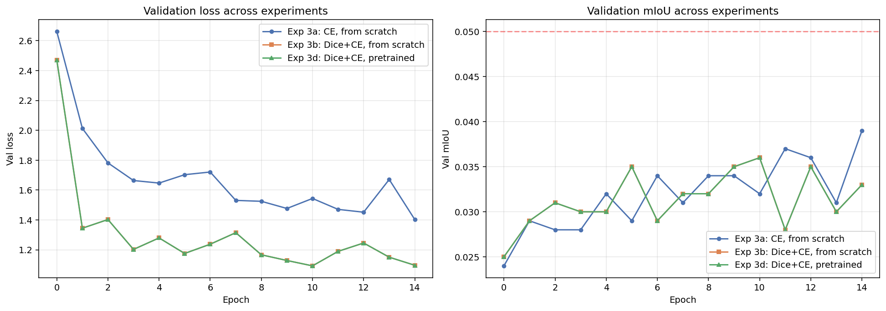
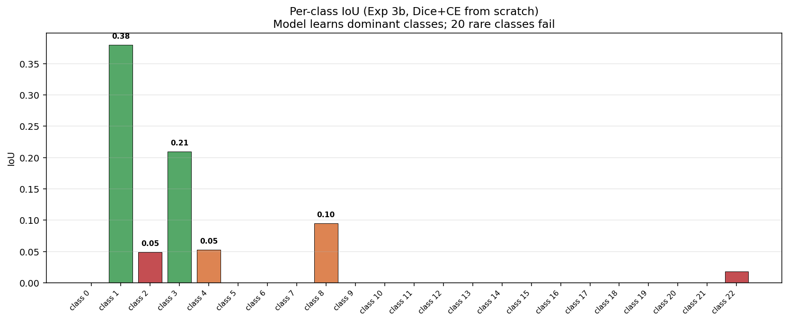
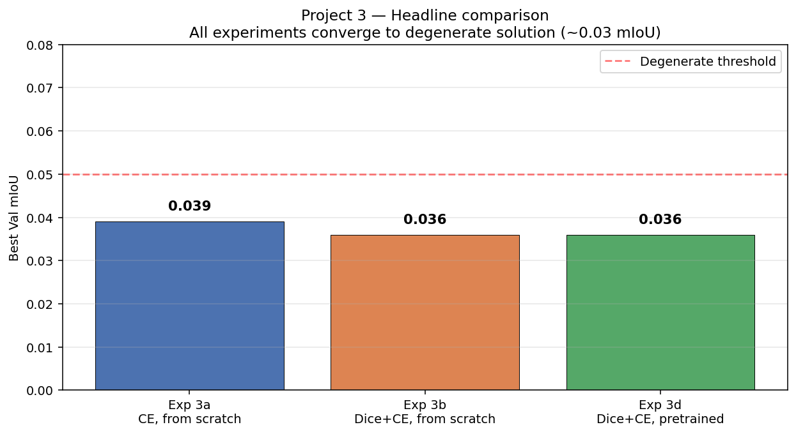

# Project 3: Semantic Segmentation on the Semantic Drone Dataset

**Course:** AI-driven Perception, Learning and Mapping for Drones — Modules 2, 5, 35–39
**Status:** Complete (with documented limitations)

## Summary

A U-Net semantic segmentation model trained on the Semantic Drone Dataset (400 drone images, 23 classes). Three experiments testing whether **loss function** or **pretrained encoder** improve segmentation performance.

## Results

| Exp | Loss | Encoder | Val mIoU | Training time |
|---|---|---|---|---|
| 3a | CrossEntropy | From scratch | **0.039** | 49 min |
| 3b | Dice+CE | From scratch | **0.035** | 49 min |
| 3d | Dice+CE | Pretrained ResNet-34 | **0.033** | 44 min |

**All three experiments converge to ~0.03 mIoU.**

## Per-class analysis

| Class | IoU | Verdict |
|---|---|---|
| Class 1 (paved-area) | 0.380 | ✅ Learned |
| Class 3 (grass/dirt) | 0.210 | ✅ Learned |
| Class 8 (vegetation) | 0.095 | Partial |
| Classes 5–21 | 0.000 | ❌ Failed |

The model learns the two dominant classes and fails on the 20 rare classes.

## Diagnosis

On a validation crop that was 100% class 1, the model predicted 100% class 1 (IoU 0.9997). The model is not broken — it correctly segments dominant classes. The bottleneck is **data distribution**: random 512×512 crops on 4000×6000 images sample rare classes with <1% probability per epoch.

## Figures

## Repository contents

- `unet_segmentation.ipynb` — full training code
- `project3_writeup.md` — detailed write-up with diagnosis
- `figures/` — training curves and per-class plots

## Key takeaways

1. Pretrained encoders are not magic — they help when the target domain is similar to ImageNet
2. Loss function selection is secondary to data distribution
3. Random cropping is a double-edged sword — increases diversity for dominant classes, destroys rare-class exposure
4. mIoU hides the story — a mean of 0.035 can mask a competent model for 2–3 classes

## What would work (future work)

- **Class-balanced patch sampling**: index rare-class images, ensure each batch contains at least one
- **Full-image training**: downsample full images to 512×768, every class present in every pass
- **Dataset expansion**: Open Cities AI (African cities) for domain diversity

## Course reference

Lectures 35–39 (semantic segmentation), Lecture 26 (feature visualization), Lecture 27 (backbones).
